 

 

I build the whole path from messy source data to a model someone can act on: **Medallion pipelines** that make data trustworthy, and **forecasting and LLM systems** that make it useful.

<table>
  <tr>
    <td width="33%" valign="top">
      <h4>🔭 Now</h4>
      Data &amp; AI Engineer at <b>Schaeffler</b>: Microsoft Fabric lakehouse and LLM-powered reporting for the global Executive Board. Open to remote and contract work.
    </td>
    <td width="33%" valign="top">
      <h4>🎓 Background</h4>
      B.Eng. Computer Engineering, <b>UNISO</b> (2026). 2 years with international teams across the Americas.
    </td>
    <td width="33%" valign="top">
      <h4>💬 Ask me about</h4>
      Lakehouse design, feature engineering, MLOps, and wiring LLMs into real data products.
    </td>
  </tr>
</table>

## 🧬 Stack, by pipeline layer

<table>
  <tr>
    <td width="150"><b>🟤 Ingest &amp; store</b></td>
    <td>
      
      
      
      
      
      
      
    </td>
  </tr>
  <tr>
    <td><b>⚪ Refine</b></td>
    <td>
      
      
      
      
      
      
      
      
    </td>
  </tr>
  <tr>
    <td><b>🟡 Model</b></td>
    <td>
      
      
      
      
      
      
      
      
    </td>
  </tr>
  <tr>
    <td><b>🔵 Serve &amp; show</b></td>
    <td>
      
      
      
      
      
      
      
      
      
      
    </td>
  </tr>
</table>

**How I work:** Scrum · Agile · process mapping · Git workflows · MLOps · data lineage

## 📌 Featured

<!-- Add more: copy the block above and change `repo=` (and the link) to another repository name. -->

## 📜 Certifications

| | Certificate | Issuer |
|:-:|:---|:---|
| 🏅 | Agile Project Management | Google · Coursera |
| 🏅 | Scrum Foundation Professional Certificate | CertiProf |
| 🏅 | Python for Data Science | Alura |
| 🏅 | Corporate Finance | NASBA |

## 📊 Activity

<picture>
  <source media="(prefers-color-scheme: dark)" srcset="https://raw.githubusercontent.com/PnkMatter/PnkMatter/output/github-snake-dark.svg"/>
  
</picture>

<b>More numbers</b>

 

